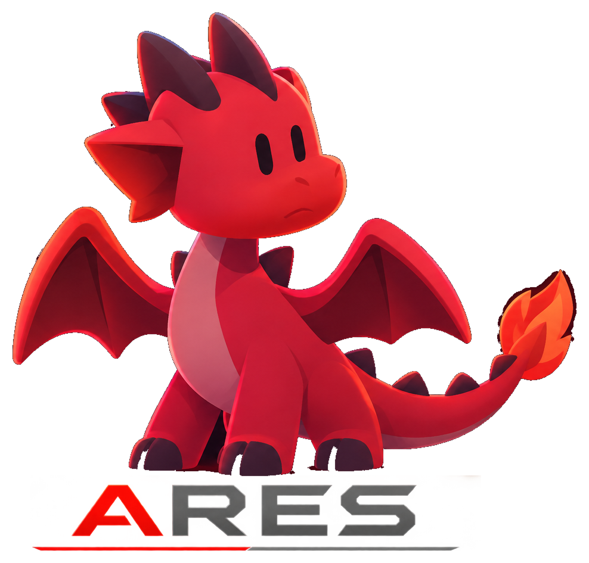
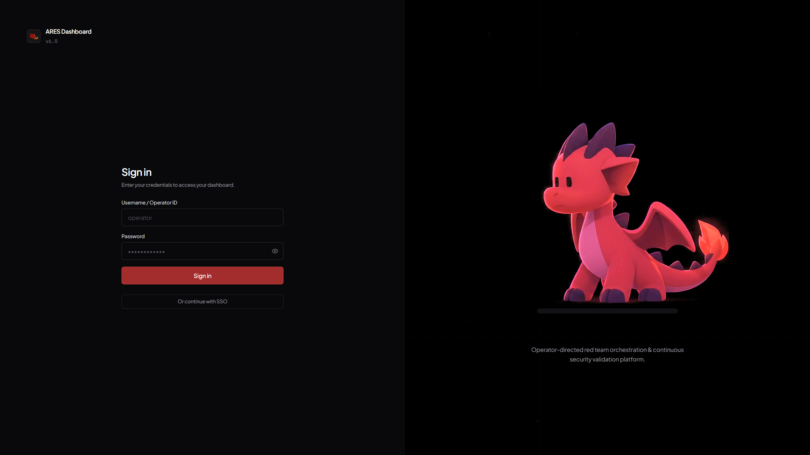
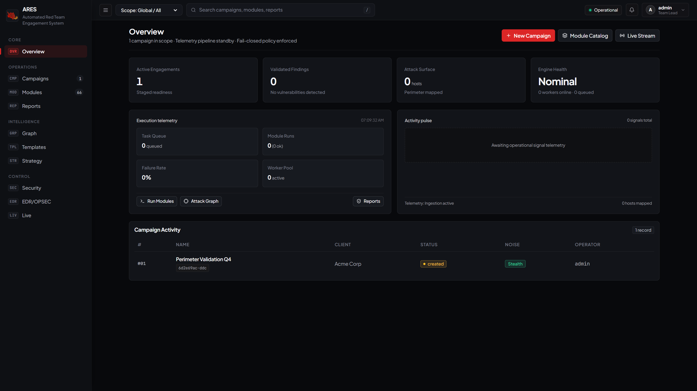
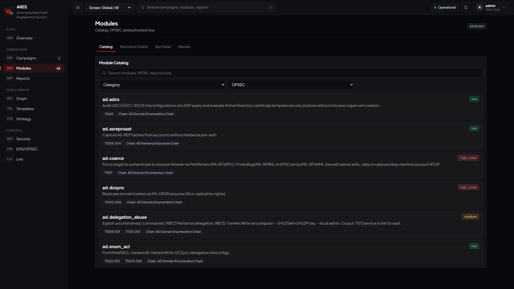
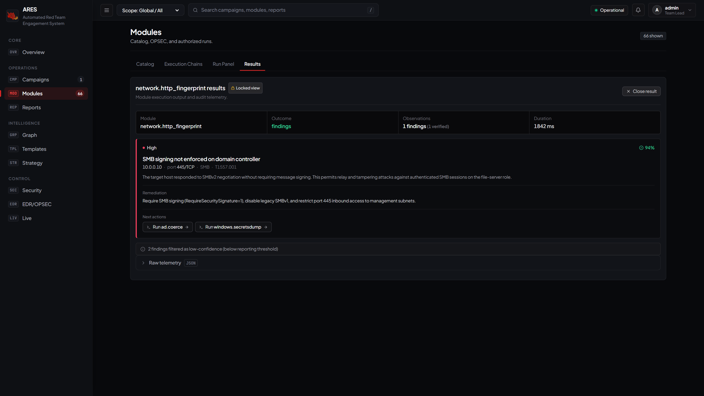
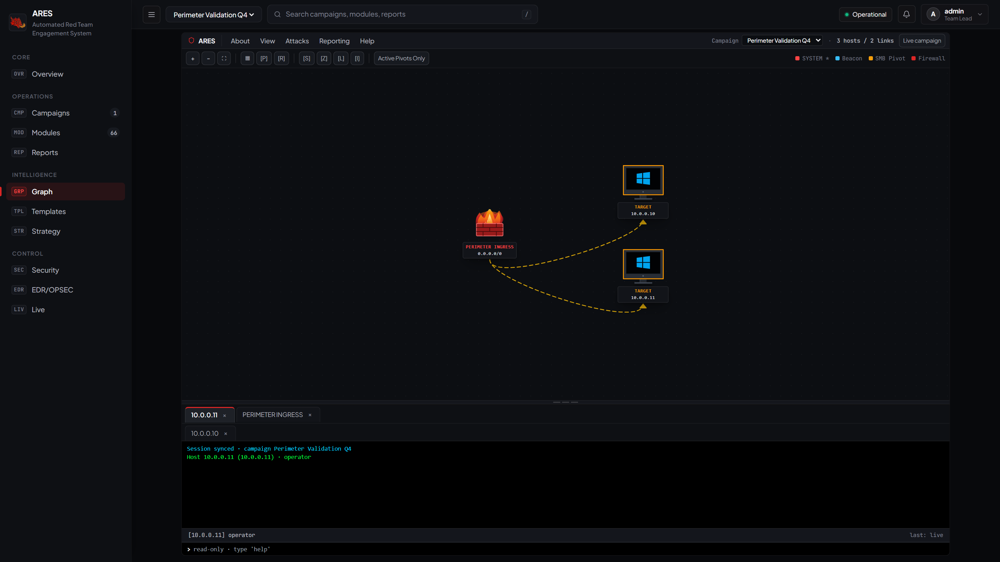
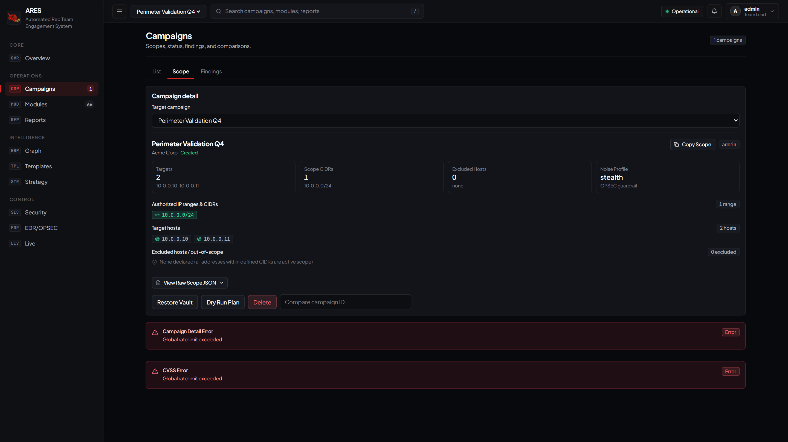

<div align="center">



### Operator-directed red team orchestration & continuous security validation

Prove exploitability. Compute shortest paths to Crown Jewels. Ship audit-ready evidence.
Built for enterprise red teams, MSSPs and security operations centers that need to validate defensive posture continuously, not once a year.

<br>

[](releases/)
[](https://python.org)
[](https://fastapi.tiangolo.com)
[](https://react.dev)
[](docs/modules.md)
[](LICENSE)
[](tests/)

[**Quickstart**](#quickstart) · [**Screens**](#screens) · [**Features**](#features) · [**Docs**](docs/) · [**Security**](docs/security-model.md) · [**Sponsor**](#support)

</div>

---

## What ARES is

A self-hosted platform that runs **real** offensive validation modules inside a fail-closed scope enclave, maps attack paths on an interactive DAG, and produces branded reports — so your SOC sees exactly what an attacker could reach today, not what a scanner thinks might be a problem.

**Not just a scanner.** ARES only reports what it actually proved on a live target, including the multi-stage chain used to prove it.

> **Why not a traditional pentest or a vulnerability scanner?** See the [market comparison matrix](docs/comparison.md).

---

## Screens

<div align="center">

<br>
*Sign-in with the ARES mascot and the SSO fallback. Memory-only JWT access tokens, HttpOnly rotating refresh.*

<br>

<br>
*Operator overview — active engagements, validated findings, attack surface, engine health, telemetry pulse.*

<br>

<br>
*Catalog — 66 active modules across 13 categories, each annotated with MITRE ATT&CK techniques and OPSEC noise level.*

<br>

<br>
*Results — finding card with severity, confidence, remediation and one-click pivot to the next module.*

<br>

<br>
*Attack graph — perimeter firewall (fire animation), targets, pivot edges. Read-only beacon telemetry per node.*

<br>

<br>
*Campaign scope — target campaign picker, Restore Vault / Dry-Run Plan / Delete controls.*

</div>

---

## Features

- **Fail-closed scope enclave** — dual-layer ScopeGuard (application pre-check + OS/transport firewall) guarantees zero offensive packets reach out-of-scope hosts. [→ security model](docs/security-model.md)
- **Goal-directed attack planning** — set `domain_admin` or `cloud_audit`, and the decision engine synthesizes multi-stage execution paths (graph heuristics, optional LLM agents under explicit authorization). [→ engine design](docs/engine_design.md)
- **Multi-vector attack graph (DAG)** — ingest BloodHound or map sessions in real time. Shortest-path, chokepoints, lateral pivot feasibility. [→ attack graph](docs/engine_design.md)
- **Zero-trust auth model** — memory-only short-lived JWTs, HttpOnly rotating refresh, HMAC CSRF, AES-256-GCM AEAD vault (PBKDF2-HMAC-SHA256 600k). [→ security model](docs/security-model.md)
- **66 active production modules** across 60+ MITRE ATT&CK techniques (AD, cloud, credential access, exfil, lateral, recon, Windows, Linux, EDR). [→ module catalog](docs/modules.md)
- **Automated deliverables** — one-click branded PDF/HTML/Markdown/JSON reports via headless browser (no GTK deps on Windows/Linux). [→ dashboard guide](docs/dashboard-guide.md)
- **MCP Gateway** — Cursor/Claude Desktop/Windsurf/Cline can drive ARES safely under Pre-Flight ScopeGuard, anti-prompt-injection taint isolation and single-use HMAC confirmation tokens. [→ MCP spec](docs/mcp-server.md)
- **Type-safe Python SDK** — write custom modules with `BaseModule[P, R]` + `@ares_module`, simulate in `ModuleTestHarness`, automate with `AresClient`. [→ SDK docs](docs/module_sdk.md) · [→ module dev guide](docs/module-development.md)

---

## Quickstart

### Prerequisites

- **Python** 3.11 or 3.12 (3.12 recommended on Windows)
- **Node.js** v18+ (tested on v20 LTS)
- **OS** Windows 11/10, Linux (Ubuntu/Debian/Kali) or macOS

### 60 seconds (PowerShell on Windows)

```powershell
git clone https://github.com/Mafifrizi/ARES.git
Set-Location .\ARES

py -3.12 -m venv .venv
.\.venv\Scripts\python.exe -m pip install -U pip
.\.venv\Scripts\python.exe -m pip install -e ".[dev,pdf]"

Set-Location frontend ; & "C:\Program Files\nodejs\npm.cmd" ci ; Set-Location ..

$env:ARES_PDF_BROWSER = "C:\Program Files (x86)\Microsoft\Edge\Application\msedge.exe"
.\.venv\Scripts\ares.exe doctor --pdf-smoke

.\.venv\Scripts\ares.exe dashboard dev --no-reload
```

Open `http://127.0.0.1:5173/dashboard/`.
Initial operator: `admin`. Password: set `ARES_DEFAULT_ADMIN_PASSWORD` in `.env` (mandatory, minimum 12 characters, no hardcoded default).

### Tests

```powershell
pytest tests/unit -n auto -q                    # 5,074 tests, parallel
pytest tests/integration/test_postgres_*.py -q  # Postgres integration
```

### In-place upgrades (no git clone / rebuild needed)

```powershell
ares update              # add new modules only
ares upgrade             # full-system upgrade (core + db + modules + UI)
ares upgrade --check     # preview, no changes on disk
```

User databases, credentials, config and plugins are mathematically blacklisted from modification — see [in-place upgrade guarantees](docs/execution-policy.md).

---

## Documentation

Everything deep lives in [`docs/`](docs/). The main entry points:

- [**Quickstart engagement guide**](QUICKSTART.md)
- [**Documentation portal & subsystem index**](docs/README.md)
- [**Dashboard surface-by-surface manual**](docs/dashboard-guide.md)
- [**Module catalog & schemas**](docs/modules.md) · [**Module development**](docs/module-development.md) · [**SDK spec**](docs/module_sdk.md)
- [**API reference**](docs/api-reference.md) · [**MCP gateway**](docs/mcp-server.md) · [**Enterprise SSO (SAML/OIDC)**](docs/sso-setup.md)
- [**Security & threat model**](docs/security-model.md) · [**Execution policy**](docs/execution-policy.md) · [**Validation lab**](docs/validation-lab.md)
- [**Architecture**](docs/architecture.md) · [**Engine design**](docs/engine_design.md) · [**Worker architecture**](docs/worker_architecture.md) · [**Database migrations**](docs/database-migrations.md)
- [**Market comparison**](docs/comparison.md) · [**RFC 001: Linux AD cross-platform tradecraft**](docs/research/linux-active-directory-tradecraft.md)

---

## Support

If ARES has accelerated your assessments or protected your infrastructure, consider sponsoring continued feature development, threat research and lab infrastructure:

<div align="center">

| | |
| :--- | :--- |
| [](https://github.com/sponsors/Mafifrizi) | International (recurring / one-time) |
| [](https://saweria.co/mafifrizi) | Indonesia (QRIS, GoPay, OVO, Dana) |

</div>

---

## Credits

<div align="center">

<a href="https://www.linkedin.com/in/muhamad-d-alvito-58607934b/">
  
</a>

**[Muhamad D Alvito](https://www.linkedin.com/in/muhamad-d-alvito-58607934b/)** — UI & UX partner

</div>

---

## Responsible use & legal disclaimer

> [!IMPORTANT]
> **ARES is a dual-use software framework designed exclusively for authorized cybersecurity research, internal enterprise resilience validation and professional red-team engagements with explicit written permission.**

- **Do not** execute ARES against any network, host or cloud infrastructure without prior written authorization from the system owners.
- Unauthorized system access or testing violates national and international cybercrime legislation (for example 18 U.S.C. § 1030 Computer Fraud and Abuse Act).
- The creators and maintainers of ARES assume no liability for misuse, damages or regulatory violations caused by this software.

To report security vulnerabilities in ARES itself, follow the [Security Policy](SECURITY.md).

### No affiliation with any cryptocurrency or token

> [!NOTE]
> This project is an **open-source security software platform**. It has **no affiliation, endorsement, partnership or association** with any cryptocurrency, coin, token, NFT, airdrop or financial instrument that uses the name "ARES" or any similar brand. We do not issue, promote or endorse any digital asset. Any such product is unrelated to this project and operates without our involvement or approval. Do not purchase or trade any such asset expecting a connection to this repository.

---

## License

ARES is distributed under the open-source **[MIT License](LICENSE)**.

<br>

<div align="center">

**ARES — Modern Red Team Engagement & Continuous Security Validation System.**<br>
*Continuous security validation. Deterministic scope containment.*

</div>
